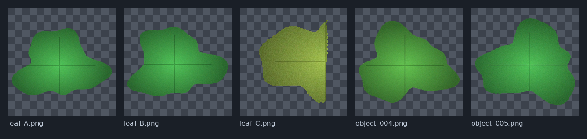

# Segmentation Tool

**Click on an object, get a clean cut-out.** Segmentation Tool outlines objects in your images with a few clicks, using Meta's [SAM 2](https://github.com/facebookresearch/sam2) model. It works with ordinary photos *and* with multispectral and hyperspectral images, and it runs on your own computer — your images never leave it.


## What you can do

- **Point at it.** Click an object to outline it. Click more spots to add to it, right-click to leave an area out, or drag a box.
- **Straighten it.** Rotate any image with one click (or the R key); Settings can rotate every image at once.
- **Fix it.** Paint with a brush to add or erase pixels, or trim a few pixels off the edge. A zoomed-in editor makes fine work easy.
- **Process whole folders.** Choose a folder of images (sub-folders are fine) and a folder for the results. Progress is remembered, so you can stop and continue another day.
- **Keep your data intact.** Photos become PNG cut-outs with a transparent background. Multispectral and hyperspectral files keep **all their bands** in the same file type, with a colour preview next to them so you can see what you saved.
- **Use your graphics card.** The app checks your GPU, explains what is missing, and installs what it needs with one click.

## Supported images

| Kind | Formats |
|---|---|
| Photos | PNG, JPG/JPEG, BMP, WebP, TIFF (rotated phone photos are shown upright) |
| Multispectral / hyperspectral | ENVI (`.hdr` + data file), multi-band TIFF, NumPy (`.npy`, `.npz`), MATLAB (`.mat`, including v7.3) |
| Cameras | Specim IQ capture folders are recognised and shown upright automatically |

## Install and start

You need a Windows, macOS or Linux computer and an internet connection for the first start. You do **not** need to install Python, Git or Node.

1. **Download** this project: click the green **Code** button on GitHub → **Download ZIP**, then unzip it. (Or `git clone` it.)
2. **Start it**
   - **Windows:** double-click `start.bat`
   - **macOS:** double-click `start.command` (if macOS blocks it, right-click → Open)
   - **Linux:** run `./start.sh` in a terminal
3. The first start installs the app's libraries (a minute or two) and then opens **http://127.0.0.1:8000** in your browser. Later starts take seconds.

On first use a **setup screen** asks you to choose your image folder and a results folder, then checks your computer and installs the AI engine and a model file for you. Pick the model size that suits your computer (the default is a good balance). Allow a few GB of downloads if you have an NVIDIA graphics card.

> **Status:** developed and tested on Linux with an NVIDIA GPU. The Windows and macOS launchers are written but have not been tested on those systems yet — please open an issue if something does not work.

## Using it in 60 seconds

1. Open an image from the **Images** list.
2. **Click** an object. It is outlined. Click again on missed parts, or **right-click** to exclude background.
3. Press **N** and click the next object. Name objects in the right-hand panel if you like.
4. Click **Save & next**. The cut-outs are written to your results folder and the next image opens.


The full guide is in the **[manual](docs/MANUAL.md)**; the **?** button in the app has a short version.

## What you get

Results mirror your input folders, one folder per image:

```
results/
├── segmentation_progress.json       ← remembers which images are done
└── batch_1/
    └── sample_001/
        ├── leaf_A.png               ← cut-out (transparent background)
        ├── leaf_A_mask.png          ← black-and-white mask
        ├── leaf_B.png
        ├── …
        └── objects.csv              ← size and position of every object
```



For spectral images each object is saved in the same format as the input (for example `object_001.hdr` + `object_001.img` for ENVI) plus `object_001_preview.png`. Everything about the output — format, cropping, masks, previews, CSV or COCO JSON — can be changed in **Settings → Export**.

## Graphics card (GPU)

Segmentation is much faster on a GPU. Open **Settings → Model & GPU** to see what the app found:

- **NVIDIA** cards use CUDA. The app picks the right PyTorch build for your driver and can switch you from the CPU version with one click.
- **Apple Silicon** Macs use the built-in GPU (Metal).
- Without a supported GPU the app still works on the processor, just more slowly. Choosing the *Tiny* or *Small* model helps.

## Troubleshooting

| Problem | What to do |
|---|---|
| "Running on the processor only" but I have an NVIDIA GPU | Settings → Model & GPU → **Switch to GPU version**, then restart when asked. Update your NVIDIA driver if it says the driver is too old. |
| The browser did not open | Open `http://127.0.0.1:8000` yourself. If the port is busy the start window prints the actual address. |
| No images are listed | Check the input folder in Settings → Folders. HEIC/HEIF iPhone files are not supported yet — export them as JPG. |
| Colours look odd for a spectral image | Settings → Image display → choose the red/green/blue bands yourself. |
| A spectral image is sideways | Settings → Image display → Orientation. |
| It is slow or runs out of memory | Lower the working resolution (Settings → Image display) or pick a smaller model. |

More in the [manual](docs/MANUAL.md#10-troubleshooting).

## For developers

```
backend/    FastAPI app: loaders, SAM 2 wrapper, export, setup/installer APIs
frontend/   React + TypeScript UI (built output in frontend/dist is committed)
scripts/    run_app.py — the launcher's supervisor (free port, browser, restart)
tests/      pytest suite (loaders, discovery, export, API, installer, launcher)
docs/       manual and screenshots
```

```bash
./run_dev.sh                         # API with reload on :8000 + Vite on :5173 (needs Node 20+)
uv run --group dev pytest            # backend tests
cd frontend && npm ci && npm run build   # rebuild frontend/dist before committing UI changes
```

Do not run a plain `uv sync`: PyTorch and SAM 2 are installed by the app for the user's own GPU and are deliberately not in `pyproject.toml`; a plain sync would remove them. `uv run` and `uv sync --inexact` leave them alone. Settings and downloaded models live in your user profile (`~/.config/segmentation-tool` and `~/.local/share/segmentation-tool` on Linux); set `SEGTOOL_HOME` to relocate them. Other variables: `SEGTOOL_PORT`, `SEGTOOL_NO_BROWSER=1`.

## Credits

Built on [SAM 2](https://github.com/facebookresearch/sam2) (Meta AI), [PyTorch](https://pytorch.org), [FastAPI](https://fastapi.tiangolo.com), [React](https://react.dev), [OpenCV](https://opencv.org), [spectral](https://www.spectralpython.net) and [tifffile](https://github.com/cgohlke/tifffile).
