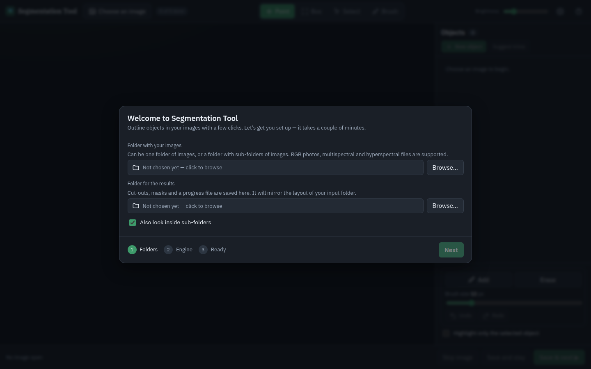
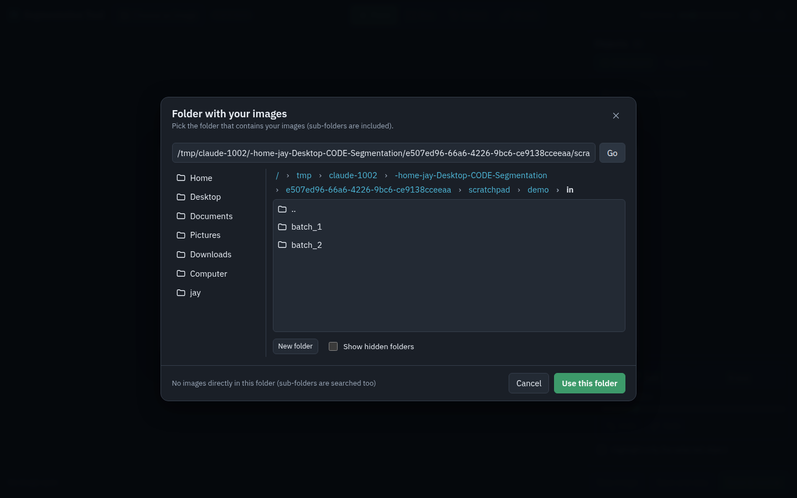
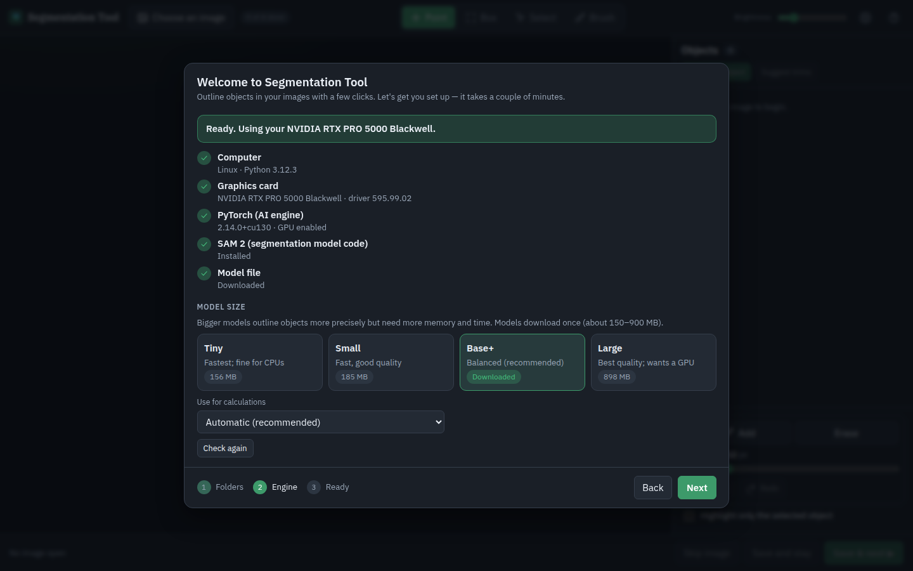
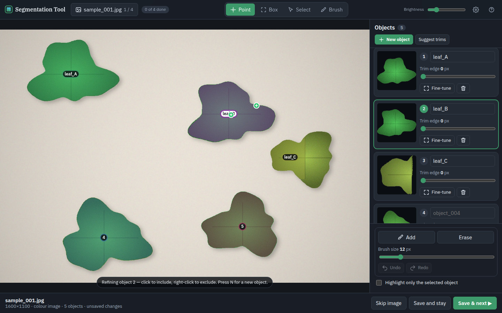
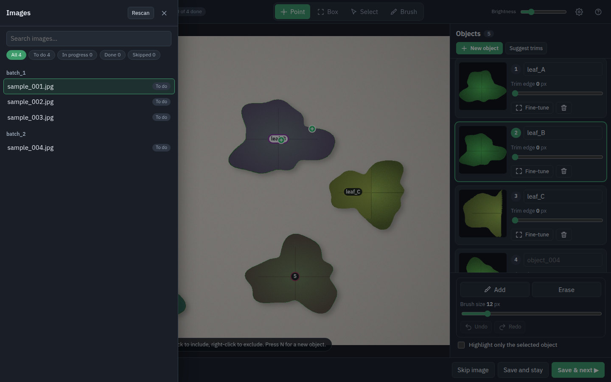
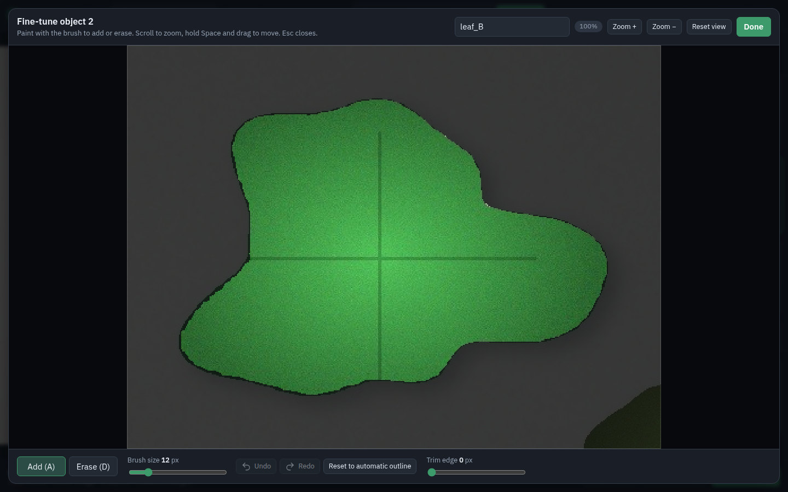
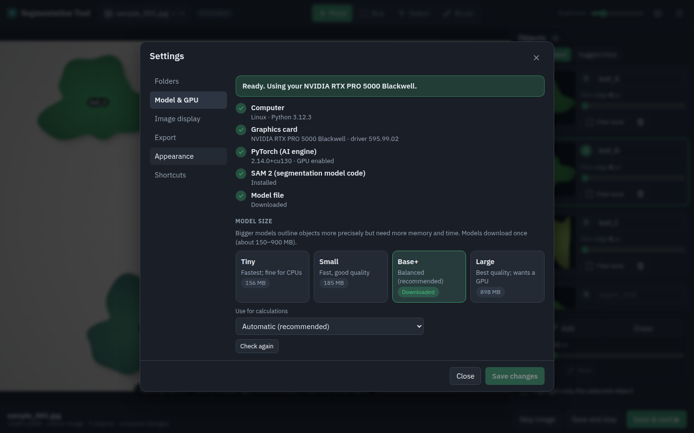
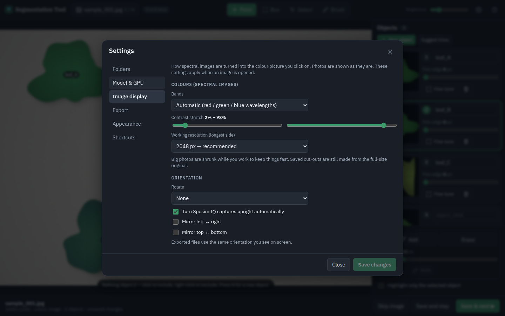
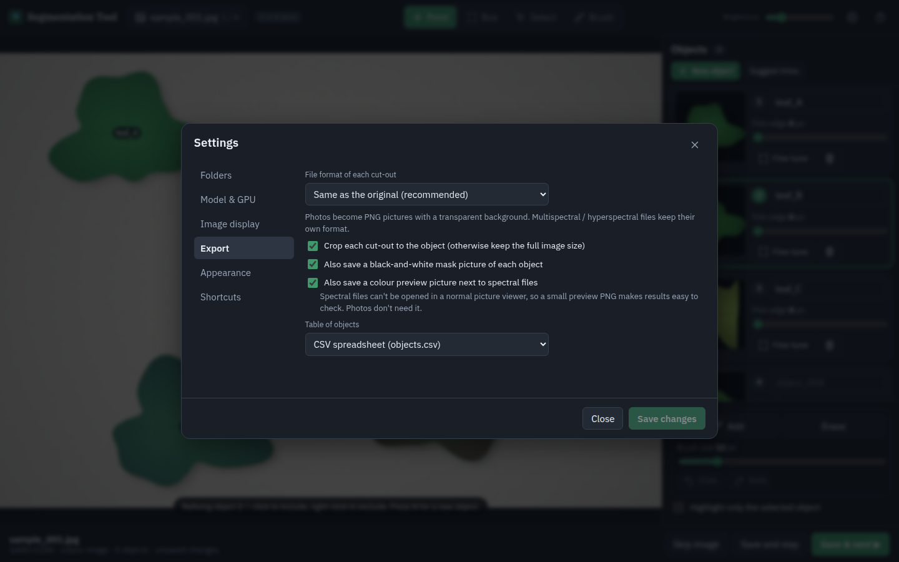

# Segmentation Tool — User Manual

This manual explains, step by step, how to use Segmentation Tool. You do not need any technical background. If you only want the short version, read [Quick start](#1-quick-start) and [Segmenting an image](#4-segmenting-an-image).

**Contents**
1. [Quick start](#1-quick-start)
2. [First-time setup](#2-first-time-setup)
3. [A tour of the screen](#3-a-tour-of-the-screen)
4. [Segmenting an image](#4-segmenting-an-image)
5. [Saving and the results folder](#5-saving-and-the-results-folder)
6. [Settings reference](#6-settings-reference)
7. [Image formats in detail](#7-image-formats-in-detail)
8. [Using your graphics card (GPU)](#8-using-your-graphics-card-gpu)
9. [Keyboard shortcuts](#9-keyboard-shortcuts)
10. [Troubleshooting](#10-troubleshooting)
11. [Glossary](#11-glossary)

---

## 1. Quick start

1. **Start the app.** Windows: double-click `start.bat`. macOS: double-click `start.command`. Linux: run `./start.sh`.
   A window with some text appears and your web browser opens the app at `http://127.0.0.1:8000`. Keep the window open while you work; closing it stops the app.
2. **Follow the setup screen** the first time (folders, AI engine, model). See [First-time setup](#2-first-time-setup).
3. **Click an object** in your image. It is outlined.
4. **Save & next.** The cut-out is saved and the next image opens.

The app runs on your own computer. Your images are not uploaded anywhere. An internet connection is only needed to install the AI engine and download the model.

## 2. First-time setup

The first time you start (and any time something essential is missing) a **setup screen** appears. It cannot be skipped, because nothing works without the AI engine and a model.

### Step 1 — Folders



- **Folder with your images** — click *Browse…* and choose it. It can contain images directly, or sub-folders full of images (any depth). The app counts what it finds ("Found 4 images").
- **Folder for the results** — where cut-outs, masks and the progress file are saved. Create a fresh one with *New folder* if you like. It must be different from the input folder. It can be inside it; the app then ignores it when listing images.
- **Also look inside sub-folders** — leave this on unless you only want the top folder.

The folder chooser shows *your* computer's folders. You can also type or paste a path and press Enter.



### Step 2 — Engine



The app checks your computer and shows a green tick for each requirement:

| Item | Meaning |
|---|---|
| **Graphics card** | Your GPU, if any. A GPU makes segmentation many times faster. |
| **PyTorch (AI engine)** | The software that runs the model. Must say *GPU enabled* if you have an NVIDIA/Apple GPU. |
| **SAM 2** | The segmentation model's code. |
| **Model file** | The trained model, downloaded once (150–900 MB). |

If something is missing, the banner turns red and a button appears next to the problem — click it and the app installs it, showing a progress bar. **Set everything up for me** does all missing steps at once. Click *Show details* to watch the log if you are curious or something fails.

**Model size.** Bigger models trace edges more precisely but need more memory and time:

| Model | Download | Good for |
|---|---|---|
| Tiny | ~156 MB | Slow computers, quick tries |
| Small | ~185 MB | Fast, good quality |
| **Base+** | ~324 MB | Balanced — the default |
| Large | ~898 MB | Best quality; wants a GPU |

Choosing a model that is not downloaded yet offers to download it. You can change the size any time in Settings.

### Step 3 — Ready

A summary of your choices. Click **Start segmenting**. The first image that still needs work opens.

If you ever delete the model file or change to a model you have not downloaded, the setup screen reappears the next time you try to open an image — you are never left with a confusing error.

## 3. A tour of the screen



| Area | What it does |
|---|---|
| **Top bar — image name** | Click it to open the **image list**. Shows `3 / 40` (position) and how many images are done. |
| **Top bar — tools** | **Point**, **Box**, **Select**, **Brush** (see below). |
| **Top bar — Brightness** | Makes the *picture* brighter or darker on your screen only. It never changes saved files. |
| **Top bar — ⚙ and ?** | Settings and the quick help panel. |
| **Picture** | Your image with the outlines on top. Scroll to zoom, hold Space and drag to move. |
| **Objects panel (right)** | One card per object: a preview, its name, **Trim edge**, **Fine-tune**, and delete. |
| **Bottom bar** | Image information and the **Skip image / Save and stay / Save & next** buttons. |

### The image list



Opens from the top bar. Images are grouped by folder and marked **To do**, **In progress** (saved but not finished), **Done** or **Skipped**. Use the search box or the filter chips to find images. *Rescan* looks for newly added files. Press Esc to close it.

## 4. Segmenting an image

### The basic idea

Each thing you want to cut out is an **object**. You tell the app *where it is* with a click; the model works out the outline. You improve the outline with more clicks. When one object is right, you start the next.

### Point tool (P)

- **Left-click** on an object — it is outlined and becomes the *active object* (highlighted card, white label).
- **Left-click** on a part that was missed — it is added.
- **Right-click** (or **Shift + click**) on a part that was wrongly included — it is excluded. Excluded points are red, included points green.
- **Click a dot** to remove that point again.
- **Backspace** removes the most recent point.

While an object is active, clicks *refine that object*. To outline a **different** object, either press **N** (new object) or just click on the other object — if you click well away from the active object, the app starts a new one for you and tells you so.

### Box tool (B)

Drag a rectangle around an object. Best for large objects, objects with several parts, or when one click picks the wrong thing. You can combine a box with points.

### Select tool (V)

Click an object (or its number label) to make it active, so that the other tools change *it*. Click empty space to deselect.

### Brush tool (A to add, D to erase)

Paint on the active object to **add** pixels (A) or **erase** them (D). Change the brush size with the slider or the `[` and `]` keys. **Ctrl/Cmd + Z** undoes a stroke; add Shift to redo. If you later change the object's points the app asks first, because that redraws the outline and discards brush work.

### Trim edge

Each object card has a **Trim edge** slider that shaves 0–50 pixels off the outline. Use it to remove a thin halo of background around the object. **Suggest trims** picks a sensible value for every object. Brush work is never trimmed.

### Fine-tune (zoomed editor)



Click **Fine-tune** on a card for a close-up. Everything outside the object is dimmed. Paint with the brush, scroll to zoom, hold Space and drag to move, press Esc or **Done** to return.

### Naming objects

Type in the name box on the card. The name becomes the file name of the saved cut-out (`leaf_A.png`). Leave it empty and the file is called `object_001`, `object_002`, … Characters that are not allowed in file names are replaced by `_`.

### Deleting and starting over

The bin icon deletes an object. **Reset brush** (appears after you paint) returns an object to the automatic outline.

## 5. Saving and the results folder

Three buttons at the bottom:

| Button | What happens |
|---|---|
| **Save & next ▶** | Saves every object, marks the image **Done**, opens the next image that needs work. |
| **Save and stay** | Saves, marks the image **In progress**, and keeps it open so you can keep going. |
| **Skip image** | Marks the image **Skipped** and moves on. Skipped images are offered again once everything else is done. |

If files with the same names already exist, the app asks before replacing them.

Progress is saved in the results folder (`segmentation_progress.json`). Close the app any time; next time it opens at the first image that is not done. To start over for an image, delete its folder in the results.

### What is saved

For an image `batch_1/sample_001.jpg`:

```
results/batch_1/sample_001/
    leaf_A.png            the cut-out, cropped to the object, transparent background
    leaf_A_mask.png       the object's mask (white = object)
    leaf_B.png …
    objects.csv           one row per object: name, file, bounding box, area, centre
```

For **spectral** images the cut-out has the same file type as the input, with every band kept and everything outside the object set to 0:

| Input | Saved as | Plus |
|---|---|---|
| ENVI `.hdr`/data | `name.hdr` + `name.img` (wavelengths kept) | `name_preview.png`, `name_mask.png` |
| Multi-band TIFF | `name.tif` | same |
| NumPy `.npy` / `.npz` | `name.npy` | same |
| MATLAB `.mat` | `name.npy` | same |

Cut-outs are always made from the **original-size** image even when the app shows you a smaller working copy (see [Working resolution](#image-display)).

## 6. Settings reference

Open with the ⚙ button. Changes in *Folders*, *Image display* and *Export* take effect when you click **Save changes**; *Model & GPU* and *Appearance* apply immediately.

### Folders
Input folder, output folder, and whether to include sub-folders. Changing the input folder re-scans for images.

### Model & GPU
The same status panel as in setup, plus **Model size** and **Use for calculations** (*Automatic* is right for almost everyone; choose *Processor only* to compare speed or avoid GPU problems).



### Image display
How spectral images become the colour picture you click on (photos are shown as they are):



- **Bands** — *Automatic* picks the bands closest to red, green and blue light from the file's wavelengths. *Choose bands myself* lets you type three band numbers (counting from 0).
- **Contrast stretch** — which dark and bright percentages are clipped. Raise the first or lower the second for more contrast.
- **Working resolution** — big photos are shrunk to this size (longest side) while you work, which keeps clicking fast and memory low. **Saved cut-outs still use the full-size original.** *Original size* disables shrinking.
- **Orientation** — rotate and mirror. The app also turns **Specim IQ** captures upright automatically (switch it off if yours are already upright). Saved files use the orientation you see.

Changing display settings re-opens the current image (unsaved objects are lost — the app asks first).

### Export


- **File format of each cut-out** — *Same as the original* (recommended), or force PNG, TIFF, NumPy or ENVI. PNG for a spectral image saves only its colour preview, not the bands.
- **Crop** — crop to the object (default) or keep the full image size.
- **Mask picture**, **colour preview next to spectral files** — on by default.
- **Table of objects** — CSV, COCO JSON (for machine-learning tools) or none.

### Appearance
Outline colour and strength, and picture brightness. Screen only.

### Shortcuts
The list in [section 9](#9-keyboard-shortcuts).

## 7. Image formats in detail

| Format | Notes |
|---|---|
| **PNG, JPG, BMP, WebP** | Treated as photos. JPG/WebP phone photos are rotated using their EXIF information. 16-bit PNGs keep their precision in the saved cut-out. Not supported: HEIC/HEIF (export from your phone as JPG). |
| **TIFF** | One or three channels (or three plus transparency) is a photo; anything else is a multi-band image. Band layout is detected from the file. |
| **ENVI** | Select the `.hdr`; the data file (`.img`, `.raw`, `.dat`, `.bil`, `.bip`, `.bsq` or no extension) must sit next to it. A header without data is ignored. |
| **Specim IQ** | A capture folder (with `results/REFLECTANCE_*.hdr`, or `capture/*.hdr`) counts as **one** image; its preview PNG and reference files are ignored. |
| **NumPy** | `(height, width, bands)` or `(bands, height, width)`; the layout is guessed (an axis much smaller than the other two is taken as bands). `.npz` files use their largest 2- or 3-dimensional array. |
| **MATLAB** | Version 5/7 and 7.3 files. The largest numeric 2- or 3-dimensional variable is used. |

**Duplicates are avoided:** an ENVI header and its data file are one image; folders and sub-folders are scanned once even if linked. If two files share a name (for example `a.png` and `a.hdr`), their output folders get a suffix (`a_png`, `a_hdr`) so nothing is overwritten.

## 8. Using your graphics card (GPU)

**How do I know it is being used?** Open Settings → Model & GPU. The top banner says *"Ready. Using your NVIDIA …"* when it is. Segmenting a click should take well under a second on a GPU.

**NVIDIA (Windows/Linux).** Needs a recent NVIDIA driver. The app reads your driver and installs the matching PyTorch build (CUDA 12.6, 12.8 or 13.0). If it finds a GPU but PyTorch is the CPU-only build, a warning offers **Switch to GPU version**; after installing, click **Restart the app now**.

**Apple Silicon.** The standard PyTorch build uses the Apple GPU automatically.

**AMD or Intel GPUs** are not supported; the app runs on the processor.

**Driver too old?** The setup screen says so. Update the NVIDIA driver from nvidia.com, then use *Check again*.

**No GPU?** Everything works, only slower. Use the **Tiny** or **Small** model and a lower working resolution.

## 9. Keyboard shortcuts

| Key | Action |
|---|---|
| **P** | Point tool (right-click or Shift+click excludes) |
| **B** | Box tool |
| **V** | Select tool |
| **A** / **D** | Brush: add / erase |
| **[** / **]** | Smaller / larger brush |
| **N** | New object |
| **Backspace** | Remove the last point of the active object |
| **Delete** | Delete the active object |
| **Ctrl/Cmd + Z** | Undo brush stroke (**Shift** for redo) |
| **Scroll** | Zoom |
| **Space + drag** | Move the picture (or middle-mouse, or Ctrl/Cmd + drag) |
| **Esc** | Deselect, or close the open window |

## 10. Troubleshooting

| Symptom | Fix |
|---|---|
| The browser says it cannot connect | The start window must stay open. Start the app again. |
| "Cannot reach the app" message in the browser | The app stopped. Start it again, then reload the page. |
| Browser did not open automatically | Open `http://127.0.0.1:8000` (the start window prints the address; it may be 8001 or higher if 8000 was busy). |
| Setup keeps showing a red problem | Click the button next to it. If an install fails, click *Show details* and check your internet connection; then try again. |
| Download is slow or stops | Models come from Meta's servers (`dl.fbaipublicfiles.com`). Corporate networks may block it — try another network. |
| It says *processor only* but I have an NVIDIA GPU | Settings → Model & GPU → **Switch to GPU version**, then restart when asked. |
| *Driver too old* | Update your NVIDIA driver. |
| Out of memory / very slow | Lower **Working resolution**, choose a smaller model, or close other programs. |
| No images listed | Check Settings → Folders. Only the formats in [section 7](#7-image-formats-in-detail) are listed; HEIC is not supported. Press *Rescan* in the image list after adding files. |
| Spectral image looks too dark, green or strange | Settings → Image display → choose bands yourself, or change the contrast stretch. Brightness (top bar) only affects the screen. |
| Spectral image is sideways | Settings → Image display → Orientation. (Specim IQ captures are turned automatically.) |
| The outline grabs the wrong thing | Right-click the wrong part to exclude it, add a box, or add more include points. |
| Outline has a thin bright/dark border | Raise **Trim edge** on that object. |
| *Files already exist* when saving | You saved this image before. Choose *Replace* to overwrite, or rename the objects. |
| I want to reset all settings | Close the app and delete the `settings.json` file in the app's settings folder (`~/.config/segmentation-tool` on Linux, `~/Library/Application Support/segmentation-tool` on macOS). |
| Start window closes instantly on Windows | Open it from a Command Prompt (`start.bat`) to read the message, and check that you have an internet connection for the first run. |

If you still need help, open an issue on GitHub and include a screenshot of **Settings → Model & GPU** and the text in the start window.

## 11. Glossary

- **Object** — one thing you want to cut out.
- **Mask** — a black-and-white picture of an object: white where the object is.
- **Cut-out** — the object's pixels with everything else removed (transparent for photos, zero for spectral data).
- **Prompt** — a click or box that tells the model where an object is.
- **SAM 2** — "Segment Anything Model 2" from Meta AI, the model that turns your clicks into outlines.
- **Band** — one slice of a spectral image: the brightness at one wavelength of light. A colour photo has 3 bands; a hyperspectral image can have hundreds.
- **Multispectral / hyperspectral** — images with several / very many bands.
- **ENVI** — a common file format for spectral images: a small `.hdr` text file plus a data file.
- **GPU** — your graphics card; it runs the model much faster than the processor.
- **CUDA** — NVIDIA's technology for running calculations on its GPUs.
- **Working resolution** — the size of the copy of the image shown and analysed while you work; saved files use the original.
